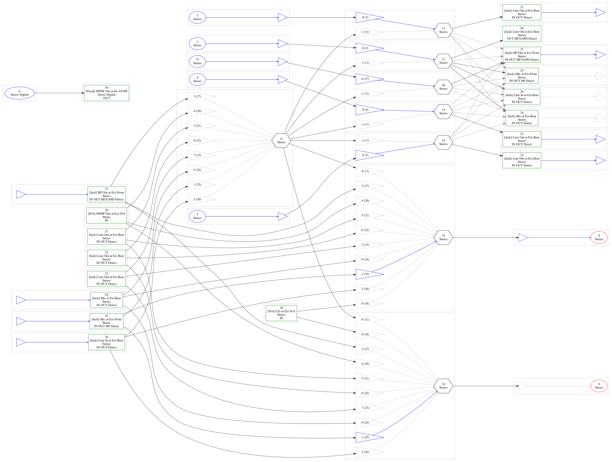
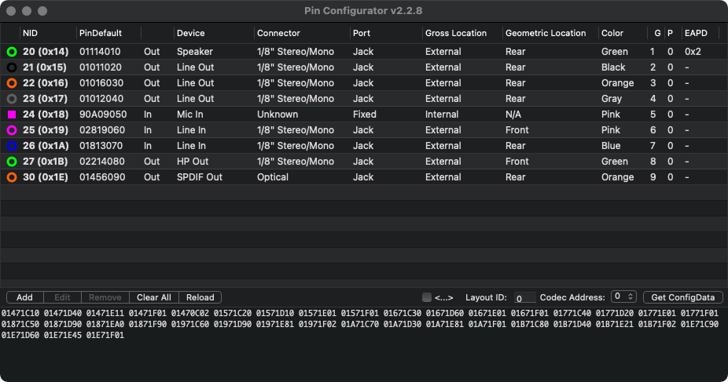

# Slimmed AppleALC kext

| | |
|---|---|
| **Mainboard** | Gigabyte Z490 Vision G |
| **Codec** | Realtek ALC1200 |
| **Included Layout** | `17` |
| **AppleALC Version** | 1.9.8 (86 kb) |

## Codec Structure

## PinConfig

## Install Instructions

The latest version of the slimmed kext is already included in my EFI folder!

- Download and extract the latest [**Slimmed AppleALC kext**](/Hardwae_Support/Audio/ALC1220/Slimmed_AppleALC)
- Replace the existing `AppleALC.kext` in your `EFI/OC/Kexts` folder
- Change the Layout-ID in boot-args or Device Properties to `17`
- Save and Reboot

> [!TIP]
> 
> If you want to use on-board in macOS Tahoe, install [**`SimpleHDA.kext`**](https://github.com/laobamac/SimpleHDA) (place it after AppleALC).

## Notes

- If you update AppleALC with OCAT or similar, this kext will be overwritten and you're back to stock.
- Don't use this kext with any other Layout-Id than 17 – it won't work!
- If you want to compile your own slimmed down AppleALC kext, you can follow my tutorial [**here**](https://github.com/5T33Z0/AppleALC-Guides/tree/main/Slimming_AppleALC)
